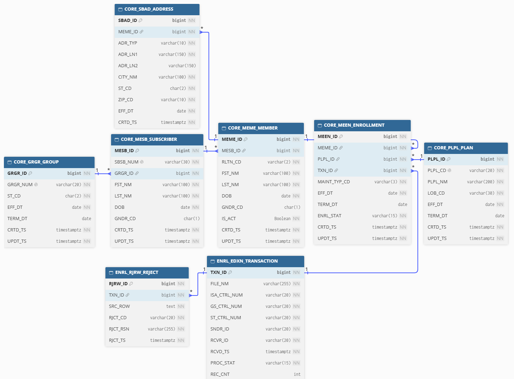
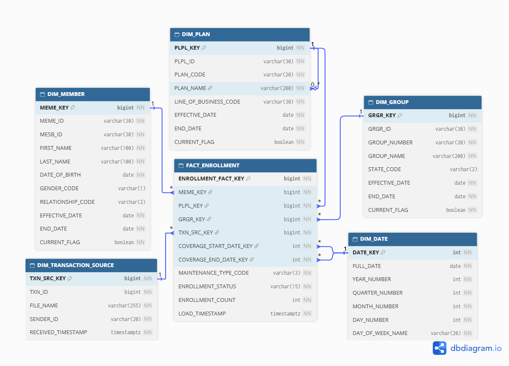

# MedEnroll834 — Modern HIPAA X12 834 Healthcare Enrollment Data Platform

[](https://sivabala21.github.io/MedEnroll834/)
[](docs-site/pdfbook/MedEnroll834-Documentation-External.pdf)
[](LICENSE)

A proof-of-concept data platform that modernizes **HIPAA X12 834** (health
benefit enrollment) transaction processing — replacing a legacy, serial,
single-machine file-handoff chain with a distributed, cloud-native
**medallion pipeline** (Bronze → Silver → Gold) on PySpark, Delta Lake,
Databricks, PostgreSQL, and Apache Airflow.

X12 834 enrollment is the representative business module; the platform
pattern — distributed processing, OLTP/OLAP separation, and dual BI/AI
analytics consumption — is designed to generalize to other high-volume
healthcare (or non-healthcare) data domains. **No production data is used
anywhere** — every 834 file is synthetically generated end to end.


## The problem

Healthcare enrollment data keeps growing — U.S. health insurance
enrollment peaked at roughly **297 million covered individuals** in late
2025 — while many organizations still process their highest-volume,
most time-sensitive data feed through a chain of five-plus specialized,
single-machine tools with no shared logging or lineage. A member's
coverage has to be correct and current before a claim can be processed
against it; long batch windows and fragmented failure handling put that
at risk. See the [Business Problem chapter](https://sivabala21.github.io/MedEnroll834/02-business-problem/)
for the full **Volume / Velocity / Variety** framing.


## What it does

- **Ingests** X12 834 enrollment files and lands them in object storage,
  traceable back to the exact source file at every downstream layer
- **Parses & validates** raw EDI segments into standardized member/
  subscriber/group/plan records, with Spark-SQL business rules that flag
  (not silently drop) invalid data
- **Transforms** through a Bronze → Silver → Gold medallion pipeline on
  Delta Lake — raw segments → validated/normalized records →
  analytics-ready, deduplicated enrollment records
- **Persists to two independent stores**: a PostgreSQL OLTP schema for
  operational reads/writes, and a Delta Lake OLAP star schema
  (`FACT_ENROLLMENT` + 5 dimensions) for analytics — deliberately kept
  separate so BI/AI query load never contends with operational traffic
- **Orchestrates** the end-to-end run with Apache Airflow (TaskFlow API),
  with automatic retries, idempotent re-runs, and run-scoped
  archive-on-success / quarantine-on-failure file handling
- **Serves analytics two ways** from the same governed Gold/OLAP data: a
  traditional SQL/HTML reporting path, and a Databricks Genie
  natural-language AI path

## Architecture

MedEnroll834 delivers three composable capabilities in the order data
flows through them:

```
Capability 1 — Distributed Processing
X12 834 → Landing (object storage) → Databricks / PySpark → Bronze → Silver → Gold

Capability 2 — Transactional Platform
Gold → PostgreSQL OLTP database → Operational applications

Capability 3 — Analytical Platform
Gold → Star Schema (Delta Lake) → Databricks SQL → BI/HTML Reports + Genie AI
```

| OLTP schema (PostgreSQL) | OLAP star schema (Delta Lake) |
|---|---|
|  |  |

Apache Airflow orchestrates the whole run — generate → land → Databricks
medallion job → OLAP star-schema build → OLTP load → HTML report → Genie
→ archive — sitting **above** the pipeline as pure orchestration, not as a
data layer itself.

## Key technologies

| Concern | Technology |
|---|---|
| Distributed processing | PySpark 4.0+, Delta Lake 4.0+ |
| Compute platform | Databricks (Serverless-compatible) |
| Orchestration | Apache Airflow 3.x (TaskFlow API, CeleryExecutor) |
| Operational store | PostgreSQL |
| Object storage | S3-compatible blob storage (POC) / AWS S3 (enterprise target) |
| Analytics | Databricks SQL warehouses + Databricks Genie (natural-language AI) |
| Containerization | Docker / Docker Compose |
| CI/CD | GitHub Actions (lint, test, security scan, build, Docker publish) |
| IaC | Terraform (S3 bucket + least-privilege IAM policy) |
| Testing | PyTest with real PySpark + Delta fixtures |

See [Chapter 5 — Technology Decisions](https://sivabala21.github.io/MedEnroll834/05-technology-decisions/)
for the reasoning behind each choice.

## Quick start

```bash
# Clone and set up
git clone https://github.com/sivabala21/MedEnroll834.git
cd MedEnroll834

# Install dependencies
pip install -r requirements.txt
pip install -e .

# Generate synthetic 834 test files (no production data anywhere)
medenroll834-generate --output 10_data/raw/ --files 3 --subs 50 --deps 2

# Run tests (real PySpark + Delta, real synthetic 834 files)
pytest 02_tests/ -v

# Start the local Airflow stack
docker compose up -d
# Airflow UI: http://localhost:8080 (admin/admin)
```

See the [End-to-End Execution runbook](https://sivabala21.github.io/MedEnroll834/33-end-to-end-execution/)
for the full deployment and run walkthrough against live Databricks/
PostgreSQL/blob storage infrastructure.

## Repository structure

```text
MedEnroll834/
├── src/medenroll834/           # the importable Python package (parsers,
│                                #   bronze/silver/gold, OLTP loader, etc.)
├── generator/                   # synthetic_834_generator.py
├── 02_tests/                    # pytest + PySpark test suite
├── 03_config/                   # pipeline_config.yaml
├── 04_infrastructure/           # Terraform (S3) + SQL DDL (OLTP + OLAP)
├── 05_orchestration/            # Airflow DAGs + Databricks notebook/job
├── 07_scripts/                  # deployment, backout, and utility scripts
├── docs-site/                   # MkDocs documentation site + PDF book builder
├── docker-compose.yaml          # Airflow 3.x stack (Celery executor)
└── pyproject.toml
```

See [Chapter 6 — Repository Structure](https://sivabala21.github.io/MedEnroll834/06-repository-structure/)
for the full directory-by-directory breakdown.

## Documentation

This project ships two parallel forms of the same 37-chapter
documentation, generated from and kept consistent with the actual source
code:

- 📖 **[Live documentation site](https://sivabala21.github.io/MedEnroll834/)** — browsable, searchable MkDocs site covering architecture, setup, every pipeline layer, orchestration, data quality, analytics, security, testing, CI/CD, and operational runbooks.
- 📄 **[Downloadable PDF book](docs-site/pdfbook/MedEnroll834-Documentation-External.pdf)** — the same content as a single, O'Reilly-styled technical book for offline reading or sharing.

## Author

**Sivabala Selvam**

[](https://github.com/sivabala21)
[](https://www.linkedin.com/in/sivabala-s/)

## License

[MIT](LICENSE)


