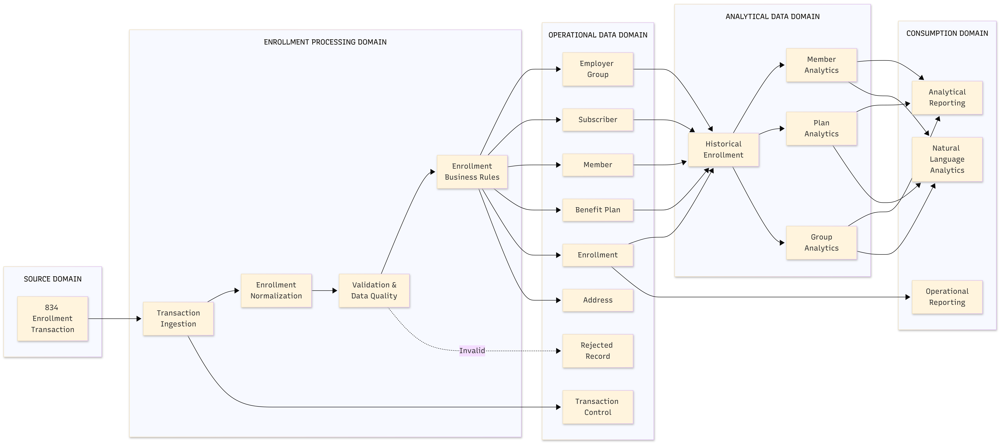

# 01. Project Overview

## Scope

MedEnroll834 is a modernization prototype for healthcare enrollment
processing. It models a production-style pipeline for inbound HIPAA X12 834
transactions — the standard EDI format carriers and employers use to enroll,
change, and terminate member benefit coverage.

The prototype demonstrates a faster, more observable, and more reliable
operating model than the legacy file-handoff chain it replaces. **It does not
use production member data** — all 834 files are synthetically generated
(see [Chapter 10](10-synthetic-data-generation.md)).

## Objectives

- Handle high-volume enrollment files through distributed processing
  (PySpark on Databricks) instead of a single-machine batch job.
- Preserve raw source data and track every transformation (Bronze → Silver →
  Gold medallion architecture with Delta Lake).
- Serve both **operational** enrollment processing (PostgreSQL OLTP) and
  **analytical** reporting (Delta Lake star schema + Databricks SQL),
  explicitly kept as two separate consumption paths.
- Demonstrate modern data-engineering practices — idempotent pipelines,
  data-quality quarantine, Airflow orchestration, CI/CD, and Infrastructure
  as Code — in a this project.

## Conceptual model

At a conceptual level, five business entities drive the whole system: a
**member** belongs to a **subscriber**'s policy, the subscriber is covered
under an **employer group**'s contract, that group offers one or more
**benefit plans**, and every addition, change, or termination to a
member's coverage is captured as an **enrollment** event. The pipeline's
entire job is to take an inbound 834 file, resolve these five entities and
the relationships between them, and make the result available two ways at
once: as live, queryable records for **operational** use (a member's
current plan, a subscriber's dependents) and as historical, aggregated
records for **analytical** use (enrollment trends by plan, by group, by
time period).



Rejected/invalid records enter a controlled remediation path (quarantine)
rather than silently failing or corrupting downstream tables — see
[Chapter 16](16-data-quality-reject-handling.md).


## Target workflow

1. Receive an 834 file from a (synthetic, in this POC) external source.
2. Land the original file in object storage (S3-compatible blob storage in
   the POC, AWS S3 in the enterprise target).
3. Parse, validate, and normalize member enrollment transactions with
   PySpark (`EDI834Parser`, `SilverLayer`).
4. Apply plan-assignment business rules (`GoldLayer`).
5. Load operational enrollment data into PostgreSQL (`load_gold_to_oltp`).
6. Publish curated Delta tables (OLAP star schema) for analytics and
   dashboards (Databricks SQL + Genie).

Apache Airflow coordinates the end-to-end workflow
(`med834_e2e_pipeline` DAG). Databricks provides scalable processing,
Delta Lake storage, and SQL analytics.

## Design principles

- **Idempotent and incremental** — natural-key upserts (`ON CONFLICT ...
  DO UPDATE`) in the OLTP loader, `overwrite`/`append` semantics with
  `mergeSchema` in the Delta layers.
- **Invalid records are quarantined** with actionable rejection reasons
  (`validation_errors` array column), not silently dropped.
- **Every run emits metrics, logs, and lineage signals** — `setup_logging`,
  `log_pipeline_start`/`log_pipeline_end`, and run summaries returned from
  each layer (`{"bronze_segments": ..., "silver_valid": ..., "gold_records": ...}`).

## Success measures

The prototype targets the legacy system's velocity, volume, and variety
constraints described in [Chapter 2](02-business-problem.md). A validated
smoke-test run (1 synthetic file, 3 subscribers + 3 dependents) produced:

```text
BRONZE     : segments_loaded = 83
SILVER     : total = 6, valid = 6, invalid = 0
GOLD       : records = 6
QUARANTINE : records = 0
```

See [Chapter 34](34-legacy-vs-modern-benchmark.md) for the full legacy vs.
modern comparison and what is measured vs. what is a design target.
