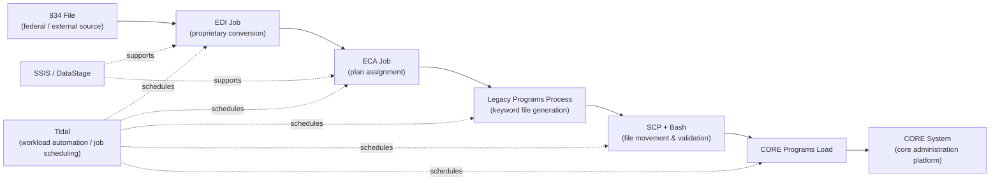

# 03. Legacy Architecture

!!! info "Conceptual overview"
    This is an illustrative view of a traditional X12 834 enrollment
    processing workflow — file ingestion, format conversion, business-rule
    application, batch orchestration, validation, and integration with a
    downstream core administration system. It represents a generalized,
    educational architecture pattern commonly seen in healthcare
    enrollment processing and is not intended to reproduce any specific
    organization's production environment, internal job names, or
    proprietary workflow details.

## Existing platform

The legacy process is a scheduled, file-based enrollment workflow. It moves
data across specialized tools before the **CORE System** receives the
final keyword file — there is no single distributed processing engine or
shared data lake underneath it.

## Processing flow

1. A federal or external source places an 834 file in a monitored folder.
2. An **EDI** job converts the 834 transaction into a proprietary format.
3. An **ECA** job processes each member and assigns a benefit plan.
4. A **Legacy Programs** process generates the keyword file.
5. **SCP** and Linux jobs move files and run **Bash** validations.
6. **CORE Programs** loads the keyword file into the **CORE System** core
   platform.

**Tidal** schedules and coordinates the jobs. **SSIS** and **DataStage**
support loading and transformation activities elsewhere in the estate.

## Operational limitations

- **Sequential file handoffs.** Each stage must complete and hand a file to
  the next tool; there is no parallelism within a stage.
- **Fragmented logging.** Each tool maintains separate logs and operational
  controls — there is no common run ID connecting an EDI failure to its
  downstream ECA or CORE System load.
- **Database contention.** Single-machine, serial processing against a
  shared database can create lock-related delays or failures under load.
- **Limited parallelism.** All transformation work happens on one machine,
  so the observed ~1 hour processing-time constraint (see
  [Chapter 2](02-business-problem.md)) cannot be improved without
  adding distributed compute.
- **Proprietary intermediate format.** The EDI → proprietary conversion
  complicates reuse: the data cannot easily be queried, re-processed, or
  fed into an analytics stack without a custom reader.
- **Operational-only data shape.** The data produced is optimized purely
  for the CORE System keyword-file load, not for broad analytics,
  historical reporting, or ad hoc BI/AI querying.

## Modernization boundary

**CORE System remains the downstream system of record** in this
prototype's conceptual framing. The modernization effort documented in
this documentation focuses on **ingestion, transformation, validation,
and data delivery** — replacing the EDI → ECA → Legacy Programs → SCP →
CORE Programs Load chain with a distributed PySpark/Delta/Airflow
pipeline (see [Chapter 4](04-modern-architecture.md)) while keeping the
downstream operational contract (an enrollment record reaching a core
administration system) conceptually the same.

