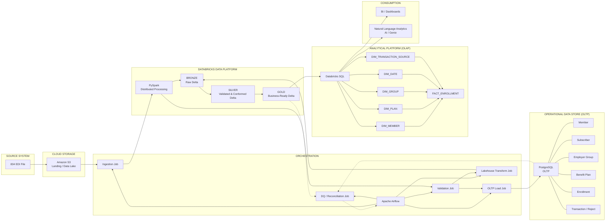

# 04. Modern Architecture

> Source: [`08_docs/01_architecture_overview/ARCHITECTURE.md`](https://github.com/yourusername/medenroll834/blob/main/08_docs/01_architecture_overview/ARCHITECTURE.md) — the canonical architecture narrative for this repository.

## Idea: Modern Distributed Data Platform for Growing Data

This proof of concept demonstrates how distributed processing can prepare a
healthcare data platform for increasing data **volume, velocity, and
variety**. X12 834 enrollment processing is the representative business
module; the architecture is designed to be reusable across other business
domains.

!!! note
    "Enrollment" names the representative POC module, not the platform
    itself. The platform capability being demonstrated is distributed
    processing plus operational/analytical separation, applicable to any
    high-volume healthcare (or other) data domain.

## Two capabilities

The architecture delivers two distinct, composable capabilities. Keeping
them conceptually separate is the core of the modernization story.

### Capability 1 — Distributed Processing

```
X12 834 → Landing (object storage) → Databricks / PySpark → Bronze → Silver → Gold
```

**Purpose:** Handle increasing Volume, Velocity, and Variety by parsing and
validating EDI data as a distributed, replayable medallion pipeline rather
than a monolithic nightly batch job.

### Capability 2 — Analytical Platform

```
Gold → Star Schema (Delta Lake) → Databricks SQL → BI/HTML Reports + Genie AI
```

**Purpose:** Separate analytical workloads from operational systems and
provide governed data for BI and AI use cases, independent of the
transactional (OLTP) store.

And, feeding the **operational** side:

```
Gold → PostgreSQL OLTP database → Operational applications
```

**Purpose:** Provide an operational relational store for application-facing
reads/writes, decoupled from analytical query load.

## Full architecture diagram



## Architecture layers

**1. Ingestion** — Synthetic / real X12 834 files land in object storage,
then get staged into a Databricks Unity Catalog Volume
(`/Volumes/med834enrl/edi/landing/834`) so serverless Databricks compute can
read them.

**2. Distributed processing (Databricks / PySpark)** — Bronze: raw X12
segments, one row per segment, schema fixed but content untouched. Silver:
validated, normalized member records with a `validation_errors` array and
`is_valid` flag; invalid rows go to DQ / Quarantine. Gold: analytics-ready
deduplicated enrollment records with derived fields (`full_name`,
`age_years`).

**3. Two downstream consumers of Gold** — OLTP load: `load_gold_to_oltp()`
upserts Gold rows into the PostgreSQL CORE/ENRL schemas for operational
applications. OLAP star schema: the same Gold data is modeled into
`DIM_MEMBER`, `DIM_PLAN`, `DIM_GROUP`, `DIM_DATE`,
`DIM_TRANSACTION_SOURCE`, and `FACT_ENROLLMENT` for BI/dashboarding and
AI/Genie natural-language analytics.

### 4. Analytical consumption — two modes

Both the HTML report and Genie
are consumers of the governed analytical layer, not steps inside the
pipeline's transformation logic.

| Mode | Flow | Use case |
|------|------|----------|
| Traditional analytics | Predefined SQL → HTML report | Fixed KPIs, scheduled reporting |
| AI analytics | Natural language → SQL → result | Ad hoc exploration via Genie |

### 5. Orchestration — Airflow

Airflow orchestrates the end-to-end
workflow, including ingestion, Databricks processing, OLTP loading,
reporting, and archival, with task dependencies, retries, and failure
handling. Airflow sits **above** the pipeline as orchestration — it is not a
data layer itself. The archive step runs with `trigger_rule="all_done"`, so
processed files are moved to the archive location regardless of whether
downstream analytical steps (report, Genie) succeeded. See
[Chapter 20](20-airflow-architecture.md).

### 6. POC vs. enterprise storage

For the proof of concept, S3-compatible
blob storage and Databricks Unity Catalog Volumes provide the development
storage path. In the target enterprise architecture, the
landing/object-storage layer can be implemented using AWS S3 while
retaining the same downstream Bronze-Silver-Gold, OLTP, OLAP, BI, and AI
architecture — the interface is already implemented in
`src/medenroll834/s3/s3_utils.py`
alongside the POC's
`src/medenroll834/storage/blob_storage.py`.

## Alignment summary

| # | Design decision | Status |
|---|------------------|--------|
| 1 | Named "Modern Distributed Data Platform for Growing Data" | Done |
| 2 | Separate OLTP (PostgreSQL) and OLAP (Delta/Star Schema) explicitly | Done |
| 3 | `FACT_ENROLLMENT` explicit at the center of the star schema | Done |
| 4 | Genie positioned as an analytical consumer, not a pipeline step | Done |
| 5 | HTML/BI and Genie positioned as two consumption paths | Done |
| 6 | POC storage (blob storage) distinguished from enterprise storage (S3) | Done |
| 7 | Airflow kept as orchestration, not a data layer | Done |

See also: [End-to-End Execution](33-end-to-end-execution.md) and
[Docker / Local Development](32-docker-local-development.md) (includes
the backout/rollback procedures).

