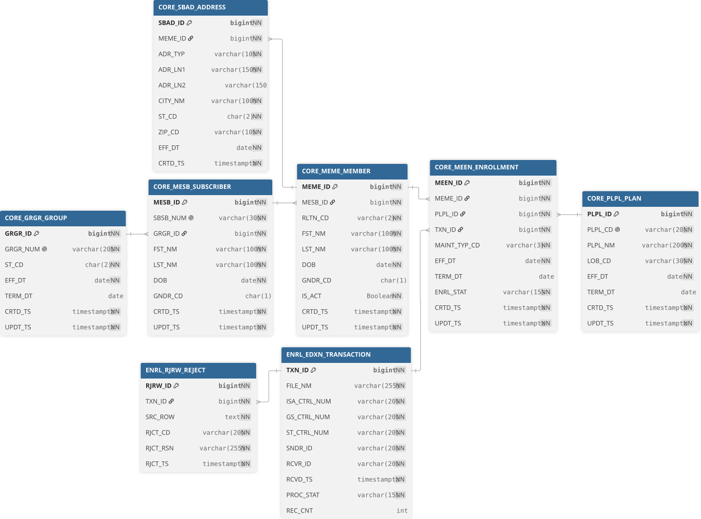
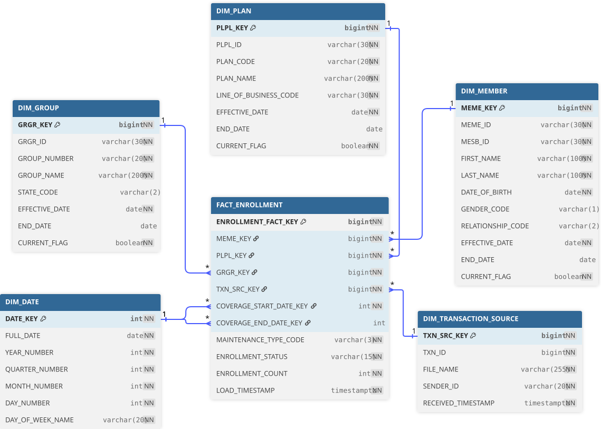

# 09. Database Schema

MedEnroll834 has **two physically separate schemas**: an OLTP relational
model in PostgreSQL and an OLAP star schema in Delta Lake. This chapter
documents both with their actual DDL.

## OLTP schema (PostgreSQL)

> Source: [`04_infrastructure/02_sql/02_oltp/`](https://github.com/yourusername/medenroll834/blob/main/04_infrastructure/02_sql/02_oltp/)



### CORE schema

| Table | Key columns | Purpose |
|---|---|---|
| `CORE_GRGR_GROUP` | `GRGR_ID` PK, `GRGR_NUM` unique | Employer group |
| `CORE_PLPL_PLAN` | `PLPL_ID` PK, `PLPL_CD` unique | Benefit plan |
| `CORE_MESB_SUBSCRIBER` | `MESB_ID` PK, `SBSB_NUM` unique, FK → `GRGR_ID` | Policy subscriber |
| `CORE_MEME_MEMBER` | `MEME_ID` PK, FK → `MESB_ID` | Member (subscriber or dependent), `RLTN_CD` relationship code |
| `CORE_SBAD_ADDRESS` | `SBAD_ID` PK, FK → `MEME_ID` | Member address |
| `CORE_MEEN_ENROLLMENT` | `MEEN_ID` PK, FK → `MEME_ID`, `PLPL_ID`, `TXN_ID` | Enrollment event |

### ENRL schema

| Table | Key columns | Purpose |
|---|---|---|
| `ENRL_EDXN_TRANSACTION` | `TXN_ID` PK | One row per ingested 834 file (ISA/GS/ST control numbers, `PROC_STAT`) |
| `ENRL_RJRW_REJECT` | `RJRW_ID` PK, FK → `TXN_ID` | Rejected source rows with reason code |

### Example DDL — `CORE_MEME_MEMBER`

```sql
CREATE TABLE IF NOT EXISTS CORE.CORE_MEME_MEMBER (
  MEME_ID BIGINT GENERATED BY DEFAULT AS IDENTITY PRIMARY KEY,
  MESB_ID BIGINT NOT NULL,
  RLTN_CD VARCHAR(2) NOT NULL,
  FST_NM VARCHAR(100) NOT NULL,
  LST_NM VARCHAR(100) NOT NULL,
  DOB DATE NOT NULL,
  GNDR_CD CHAR(1),
  IS_ACT BOOLEAN NOT NULL,
  CRTD_TS TIMESTAMPTZ NOT NULL,
  UPDT_TS TIMESTAMPTZ NOT NULL
);
```

### Foreign keys

All seven FKs are `DEFERRABLE INITIALLY IMMEDIATE`, declared in
[`04_constraints/CONSTRAINTS.sql`](https://github.com/yourusername/medenroll834/blob/main/04_infrastructure/02_sql/02_oltp/04_constraints/CONSTRAINTS.sql):

```sql
ALTER TABLE CORE.CORE_MESB_SUBSCRIBER ADD CONSTRAINT FK_CORE_MESB_SUBSCRIBER_GRGR_ID
  FOREIGN KEY (GRGR_ID) REFERENCES CORE.CORE_GRGR_GROUP (GRGR_ID) DEFERRABLE INITIALLY IMMEDIATE;
ALTER TABLE CORE.CORE_MEME_MEMBER ADD CONSTRAINT FK_CORE_MEME_MEMBER_MESB_ID
  FOREIGN KEY (MESB_ID) REFERENCES CORE.CORE_MESB_SUBSCRIBER (MESB_ID) DEFERRABLE INITIALLY IMMEDIATE;
-- ... and 5 more (address→member, enrollment→member/plan/transaction, reject→transaction)
```

### Indexes

16 indexes support the common operational access patterns — foreign-key
columns, status/date filters, and one composite index
(`IX_CORE_MEEN_ENROLLMENT_MEME_PLPL` on `(MEME_ID, PLPL_ID)`) for the
member-plan lookup path. See
[`03_indexes/INDEXES.sql`](https://github.com/yourusername/medenroll834/blob/main/04_infrastructure/02_sql/02_oltp/03_indexes/INDEXES.sql).

## OLAP star schema (Delta Lake)

> Source: [`04_infrastructure/02_sql/03_olap/04_gold/`](https://github.com/yourusername/medenroll834/blob/main/04_infrastructure/02_sql/03_olap/04_gold/)



`FACT_ENROLLMENT` sits at the center, surrounded by five dimensions — all
Delta tables in the `GOLD` schema:

```sql
CREATE TABLE IF NOT EXISTS GOLD.FACT_ENROLLMENT (
  ENROLLMENT_FACT_KEY BIGINT GENERATED BY DEFAULT AS IDENTITY PRIMARY KEY,
  MEME_KEY BIGINT NOT NULL,
  PLPL_KEY BIGINT NOT NULL,
  GRGR_KEY BIGINT NOT NULL,
  TXN_SRC_KEY BIGINT NOT NULL,
  COVERAGE_START_DATE_KEY INT NOT NULL,
  COVERAGE_END_DATE_KEY INT,
  MAINTENANCE_TYPE_CODE STRING NOT NULL,
  ENROLLMENT_STATUS STRING NOT NULL,
  ENROLLMENT_COUNT INT NOT NULL,
  LOAD_TIMESTAMP TIMESTAMP NOT NULL
)
USING DELTA
COMMENT 'Gold enrollment fact. Grain: one row per enrollment event.';
```

### Dimensions (all SCD Type 2 via `CURRENT_FLAG`, except `DIM_DATE`)

| Dimension | Surrogate key | Natural key | Notes |
|---|---|---|---|
| `DIM_MEMBER` | `MEME_KEY` | `MEME_ID` | First/last name, DOB, relationship code |
| `DIM_PLAN` | `PLPL_KEY` | `PLPL_ID` | `PLAN_CODE`, `PLAN_NAME`, line of business |
| `DIM_GROUP` | `GRGR_KEY` | `GRGR_ID` | Group number, name, state |
| `DIM_DATE` | `DATE_KEY` (PK = `YYYYMMDD` int) | — | Year/quarter/month/day/day-name, no SCD needed |
| `DIM_TRANSACTION_SOURCE` | `TXN_SRC_KEY` | `TXN_ID` | File name, sender id, received timestamp |

See [Chapter 19](19-olap-star-schema.md) for how the Databricks notebook
actually resolves these surrogate keys when building `FACT_ENROLLMENT`.

## Schema deployment order

| Store | Script | Order |
|---|---|---|
| OLTP | `07_scripts/02_deployment/deploy_oltp_database.py` | Schemas → tables → indexes → constraints → comments |
| OLAP | `07_scripts/02_deployment/deploy_databricks_olap.py` | Schemas → dimension tables → fact table → constraints |

Both are idempotent (`CREATE TABLE IF NOT EXISTS`, `DROP ... IF EXISTS`
before recreate) and have matching backout scripts documented in the
[Backout Runbook](https://github.com/yourusername/medenroll834/blob/main/08_docs/04_operations_deployment/BACKOUT_RUNBOOK.md).
