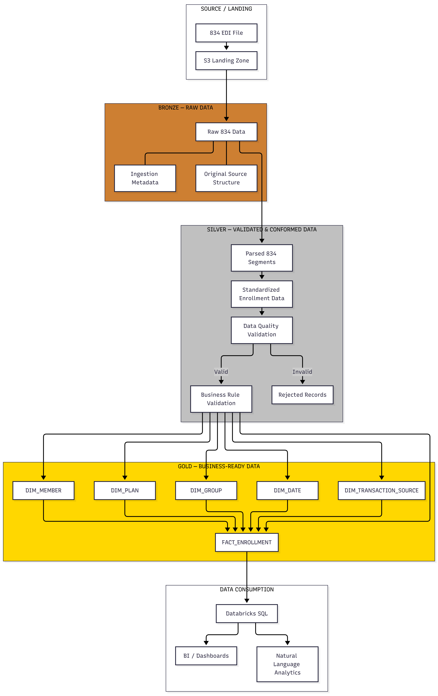

# 13. Bronze Layer

> Source: [`src/medenroll834/ingestion/bronze.py`](https://github.com/yourusername/medenroll834/blob/main/src/medenroll834/ingestion/bronze.py)

The Bronze layer is the **raw, untransformed** landing zone: one row per
X12 segment, schema fixed, content untouched beyond splitting into
elements. Its job is to preserve the source data exactly as received, so
every downstream transformation can be replayed or audited against it.



## `BronzeLayer.ingest()`

```python
class BronzeLayer:
    def __init__(self, spark: SparkSession, config: Dict):
        self.spark = spark
        self.config = config

    def ingest(self, landing_path: str) -> DataFrame:
        self.logger = setup_logging("bronze")
        start_time = log_pipeline_start(self.logger, "BRONZE", f"landing_path={landing_path}")

        path = Path(landing_path)
        files = sorted(path.glob("*.834"))
        rows = []
        try:
            for file in files:
                content = file.read_text(encoding="utf-8")
                file_name = file.name
                for seg_order, line in enumerate(split_segments(content)):
                    elements = line.split("*")
                    rows.append({
                        "file_name": file_name,
                        "segment_id": elements[0],
                        "elements": elements,
                        "raw_segment": line,
                        "seg_order": seg_order,
                    })

            parsed = self.spark.createDataFrame(rows, schema=BRONZE_SCHEMA)
            parsed = parsed.withColumn("ingested_at", F.current_timestamp().cast("string"))

            table_path = self.config["layers"]["bronze"]["path"]
            (
                parsed.write.format("delta")
                .mode("overwrite")
                .option("mergeSchema", "true")
                .option("delta.autoOptimize.optimizeWrite", "true")
                .save(table_path)
            )
        except Exception:
            log_pipeline_error(self.logger, "BRONZE", f"landing_path={landing_path}", start_time)
            raise

        result_count = parsed.count()
        log_pipeline_end(self.logger, "BRONZE", f"segments_loaded={result_count}", start_time)
        return parsed
```

## Write semantics

| Option | Value | Why |
|---|---|---|
| `mode` | `overwrite` | Each pipeline run ingests the current landing directory's files as a fresh Bronze snapshot |
| `mergeSchema` | `true` | Tolerates schema drift (e.g. an added column) without a manual `ALTER TABLE` |
| `delta.autoOptimize.optimizeWrite` | `true` | Compacts small files at write time — important because 834 ingestion produces many small per-file row batches |

## Output schema

```python
BRONZE_SCHEMA = StructType([
    StructField("file_name", StringType(), True),
    StructField("segment_id", StringType(), True),
    StructField("elements", ArrayType(StringType()), True),
    StructField("raw_segment", StringType(), True),
    StructField("seg_order", LongType(), True),
    StructField("ingested_at", StringType(), True),
])
```

Stored at the Delta path configured in
[`03_config/pipeline_config.yaml`](https://github.com/yourusername/medenroll834/blob/main/03_config/pipeline_config.yaml):

```yaml
layers:
  bronze:
    path: 10_data/bronze/edi834_segments
    table: bronze_edi_segments
    format: delta
    options:
      mergeSchema: "true"
      delta.autoOptimize.optimizeWrite: "true"
```

On Databricks, the equivalent table is `med834enrl.edi.bronze_edi_segments`
(see
[`04_infrastructure/02_sql/01_delta/bronze_edi_segments.sql`](https://github.com/yourusername/medenroll834/blob/main/04_infrastructure/02_sql/01_delta/bronze_edi_segments.sql)).

## Databricks notebook equivalent

The production Databricks job
([`05_orchestration/databricks/med834_medallion_job.py`](https://github.com/yourusername/medenroll834/blob/main/05_orchestration/databricks/med834_medallion_job.py))
implements the same Bronze logic using `read_files()` SQL + `explode()`
instead of a Python loop over local files, because it reads from a Unity
Catalog Volume rather than the local filesystem:

```python
raw = spark.sql(
    f"SELECT value, element_at(split(_metadata.file_path, '/'), -1) AS file_name "
    f"FROM read_files('{LANDING}', format => 'text', wholeText => true)"
)
bronze = (
    raw.withColumn("segment", F.explode(F.split(F.regexp_replace("value", r"[\r\n]+", "~"), "~")))
    .filter(F.trim("segment") != "")
    .withColumn("elements", F.split(F.col("segment"), r"\*"))
    .withColumn("segment_id", F.element_at("elements", 1))
    .withColumn("seg_order", F.monotonically_increasing_id())
    .withColumn("raw_segment", F.col("segment"))
    .withColumn("ingested_at", F.current_timestamp())
    .select("file_name", "segment_id", "elements", "raw_segment", "seg_order", "ingested_at")
)
bronze.write.format("delta").mode("overwrite").option("overwriteSchema", "true") \
    .saveAsTable(f"{EDI}.bronze_edi_segments")
```

Same segment-normalization idea (`~`/newline → `~`), same per-segment
`elements` array shape — just expressed in distributed SQL/DataFrame
operations instead of a Python-side file loop, because `read_files()` and
`explode()` are what scale across a Databricks cluster reading many files
from a Volume at once.

## Pipeline summary contribution

`BronzeLayer.ingest()`'s row count feeds directly into the
`DeltaMedallionPipeline.run()` summary dict (see
[Chapter 18](18-gold-layer.md)):

```python
summary = {
    "bronze_segments": bronze_df.count(),
    ...
}
```
