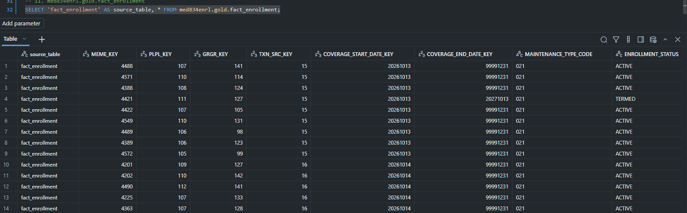

# 19. OLAP Star Schema

> Source: [`05_orchestration/databricks/med834_medallion_job.py`](https://github.com/yourusername/medenroll834/blob/main/05_orchestration/databricks/med834_medallion_job.py)
> (section `# ---------- OLAP star-schema dimensions ----------`)

The OLAP star schema is built directly in the Databricks notebook job,
immediately after the medallion Bronze/Silver/Gold run, from the same
`gold_enrollments` table. `FACT_ENROLLMENT` sits at the center, surrounded
by five dimensions — see [Chapter 9](09-database-schema.md) for the full
DDL and ERD.

## Dimension builds (all `SCD Type 2`-shaped via `CURRENT_FLAG`)

```python
g = spark.table(f"{EDI}.gold_enrollments")

# DIM_PLAN - PLAN_TIER_NAME maps the numeric plan code (e.g. "100") to a
# readable tier label ("GOLD", "SILVER", ...) for PLAN_NAME synthesis.
(g.select(F.col("plan_id").alias("PLPL_ID"), F.col("plan_id").alias("PLAN_CODE"),
          F.concat(F.coalesce(PLAN_TIER_NAME[F.col("plan_id")], F.col("plan_id")), F.lit(" Plan")).alias("PLAN_NAME"))
  .withColumn("LINE_OF_BUSINESS_CODE", F.lit("COMMERCIAL")).dropDuplicates(["PLPL_ID"])
  .withColumn("EFFECTIVE_DATE", F.current_date()).withColumn("END_DATE", F.to_date(F.lit("9999-12-31")))
  .withColumn("CURRENT_FLAG", F.lit(True))
  .write.format("delta").mode("overwrite").option("mergeSchema", "true").saveAsTable(f"{GOLD}.dim_plan"))

# DIM_GROUP - GRGR_ID/GROUP_NUMBER come from the REF*1L group number captured
# in Silver, not a hardcoded default.
(g.select(F.col("group_id").alias("GRGR_ID"), F.col("group_id").alias("GROUP_NUMBER"),
          F.col("group_name").alias("GROUP_NAME"), F.col("state").alias("STATE_CODE")).dropDuplicates(["GRGR_ID"])
  .withColumn("EFFECTIVE_DATE", F.current_date()).withColumn("END_DATE", F.to_date(F.lit("9999-12-31")))
  .withColumn("CURRENT_FLAG", F.lit(True))
  .write.format("delta").mode("overwrite").option("mergeSchema", "true").saveAsTable(f"{GOLD}.dim_group"))

# DIM_MEMBER
(g.select(F.col("member_id").alias("MEME_ID"), F.col("member_id").alias("MESB_ID"),
          F.col("first_name").alias("FIRST_NAME"), F.col("last_name").alias("LAST_NAME"),
          F.to_date("date_of_birth", "yyyyMMdd").alias("DATE_OF_BIRTH"), F.col("gender").alias("GENDER_CODE"),
          F.lit("18").alias("RELATIONSHIP_CODE")).dropDuplicates(["MEME_ID"])
  .withColumn("EFFECTIVE_DATE", F.current_date()).withColumn("END_DATE", F.to_date(F.lit("9999-12-31")))
  .withColumn("CURRENT_FLAG", F.lit(True))
  .write.format("delta").mode("overwrite").option("mergeSchema", "true").saveAsTable(f"{GOLD}.dim_member"))
```

`END_DATE` is never `NULL` — an active/open-ended dimension row stores the
fixed `9999-12-31` sentinel instead, so "no end date yet" is a real,
queryable date rather than `NULL` (see [Chapter 9](09-database-schema.md)).


## `DIM_DATE` — generated date spine

Rather than hardcoding a date range, `DIM_DATE` is generated to span the
actual min/max coverage dates seen in Gold, padded by a year on each side:

```python
date_bounds = g.select(
    F.to_date("coverage_start_date", "yyyyMMdd").alias("d1"),
    F.to_date("coverage_end_date", "yyyyMMdd").alias("d2"),
).agg(F.min("d1").alias("min_d"), F.max(F.greatest("d1", "d2")).alias("max_d")).first()
min_d = (date_bounds["min_d"] or today) - timedelta(days=365)
max_d = (date_bounds["max_d"] or today) + timedelta(days=365)

dim_date = (
    spark.sql(f"SELECT explode(sequence(to_date('{min_d}'), to_date('{max_d}'), interval 1 day)) AS FULL_DATE")
    .withColumn("DATE_KEY", F.date_format("FULL_DATE", "yyyyMMdd").cast("int"))
    .withColumn("YEAR_NUMBER", F.year("FULL_DATE"))
    .withColumn("QUARTER_NUMBER", F.quarter("FULL_DATE"))
    .withColumn("MONTH_NUMBER", F.month("FULL_DATE"))
    .withColumn("DAY_NUMBER", F.dayofmonth("FULL_DATE"))
    .withColumn("DAY_OF_WEEK_NAME", F.date_format("FULL_DATE", "EEEE"))
)
```

`DATE_KEY` is an `INT` in `YYYYMMDD` form (e.g. `20260827`), matching the
surrogate-key convention documented in the table comment:
`'DATE_KEY uses YYYYMMDD format (e.g., 20260827 = 27-Aug-2026)'`.

A fixed sentinel row is appended with `DATE_KEY = 99991231` /
`FULL_DATE = 9999-12-31` / `DAY_OF_WEEK_NAME = "Open Ended"`, so
`FACT_ENROLLMENT.COVERAGE_END_DATE_KEY` always has a valid `DIM_DATE` row to
join against even for open-ended coverage — see below.

## `DIM_TRANSACTION_SOURCE` — hashed file identity

```python
dim_txn_src = (
    g.select("file_name").dropDuplicates()
    .withColumn("TXN_ID", F.abs(F.xxhash64("file_name")))
    .withColumn("FILE_NAME", F.col("file_name"))
    .withColumn("SENDER_ID", F.lit("SENDERID"))
    .withColumn("RECEIVED_TIMESTAMP", F.current_timestamp())

## `FACT_ENROLLMENT` — resolving surrogate keys

The fact table is built by joining Gold against the **current** row of
each dimension (`CURRENT_FLAG = true`) on natural keys, then selecting
only the surrogate keys:

```python
dim_member_cur = spark.table(f"{GOLD}.dim_member").filter("CURRENT_FLAG = true") \
    .select(F.col("MEME_KEY"), F.col("MEME_ID").alias("jk_meme_id"))
dim_plan_cur = spark.table(f"{GOLD}.dim_plan").filter("CURRENT_FLAG = true") \
    .select(F.col("PLPL_KEY"), F.col("PLPL_ID").alias("jk_plpl_id"))
# ... dim_group_cur, dim_txn_tbl similarly ...

fact = (
    g.withColumn("jk_cov_start_key", F.date_format(F.to_date("coverage_start_date", "yyyyMMdd"), "yyyyMMdd").cast("int"))
     # Open-ended coverage resolves to the 9999-12-31 sentinel key instead of NULL
     .withColumn("jk_cov_end_key", F.coalesce(
         F.date_format(F.to_date("coverage_end_date", "yyyyMMdd"), "yyyyMMdd").cast("int"),
         F.lit(99991231),
     ))
     .join(dim_member_cur, F.col("member_id") == F.col("jk_meme_id"), "left").drop("jk_meme_id")
     .join(dim_plan_cur, F.col("plan_id") == F.col("jk_plpl_id"), "left").drop("jk_plpl_id")
     .join(dim_group_cur, F.col("group_id") == F.col("jk_grgr_id"), "left").drop("jk_grgr_id")
     .join(dim_txn_tbl, F.col("file_name") == F.col("jk_file_name"), "left").drop("jk_file_name")
     .join(dim_date_start, F.col("jk_cov_start_key") == F.col("start_date_key"), "left")
     .join(dim_date_end, F.col("jk_cov_end_key") == F.col("end_date_key"), "left")
     .withColumn("MAINTENANCE_TYPE_CODE", F.lit("021"))
     .withColumn("ENROLLMENT_STATUS",
         F.when(F.col("coverage_end_date").isNull() | (F.col("coverage_end_date") == ""),
                F.lit("ACTIVE")).otherwise(F.lit("TERMED")))
     .withColumn("ENROLLMENT_COUNT", F.lit(1))
     .withColumn("LOAD_TIMESTAMP", F.current_timestamp())
     .filter(F.col("MEME_KEY").isNotNull() & F.col("PLPL_KEY").isNotNull()
             & F.col("GRGR_KEY").isNotNull() & F.col("TXN_SRC_KEY").isNotNull()
             & F.col("COVERAGE_START_DATE_KEY").isNotNull())
)
fact.write.format("delta").mode("overwrite").option("overwriteSchema", "true").saveAsTable(f"{GOLD}.fact_enrollment")
```

The final `.filter(...)` enforces **referential integrity at write time** —
a Gold row that fails to resolve against any required dimension (e.g. a
plan code dimension row wasn't built yet) is excluded from the fact table
rather than being written with a null foreign key.

## Verifying the star schema

> Source: [`07_scripts/03_utils/verify_star_schema.py`](https://github.com/yourusername/medenroll834/blob/main/07_scripts/03_utils/verify_star_schema.py)

```python
print("Sample FACT_ENROLLMENT joined to all dims:")
print(q("""
    SELECT p.PLAN_CODE, gr.GROUP_NUMBER, m.FIRST_NAME, m.LAST_NAME,
           d1.FULL_DATE AS coverage_start, f.ENROLLMENT_STATUS
    FROM med834enrl.gold.fact_enrollment f
    JOIN med834enrl.gold.dim_plan p ON f.PLPL_KEY = p.PLPL_KEY
    JOIN med834enrl.gold.dim_group gr ON f.GRGR_KEY = gr.GRGR_KEY
    JOIN med834enrl.gold.dim_member m ON f.MEME_KEY = m.MEME_KEY
    JOIN med834enrl.gold.dim_date d1 ON f.COVERAGE_START_DATE_KEY = d1.DATE_KEY
    LIMIT 5
"""))
```

See [Chapter 27](27-databricks-sql-dashboard.md) for how this star schema
is queried by the HTML report and Genie.

)
```

`xxhash64` deterministically derives a numeric `TXN_ID` from the file name,
so the same file always maps to the same transaction-source key across
runs without needing a separate sequence/lookup table.

## Verified fact table evidence



