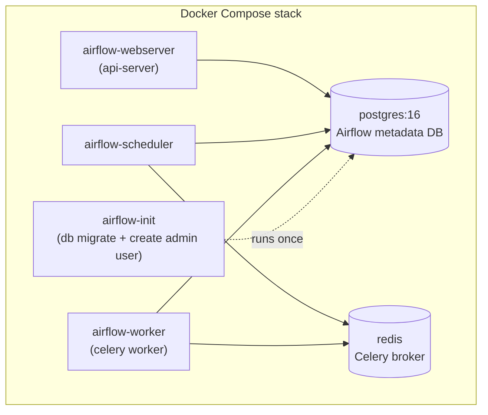

# 20. Airflow Architecture

MedEnroll834 orchestrates its end-to-end workflow with **Apache Airflow
3.x**, running in Docker Compose with the `CeleryExecutor`. Airflow sits
**above** the pipeline as pure orchestration — it owns scheduling,
retries, task dependencies, and failure handling, but no transformation
logic itself lives in a DAG task beyond thin calls into
`src/medenroll834/`.

## Stack topology

> Source: [`docker-compose.yaml`](https://github.com/yourusername/medenroll834/blob/main/docker-compose.yaml)



| Service | Role |
|---|---|
| `postgres` | Airflow's own metadata database (separate from the pipeline's OLTP database) |
| `redis` | Celery broker for task distribution to workers |
| `airflow-webserver` | `api-server` command — serves the UI at `localhost:8080` |
| `airflow-scheduler` | Parses DAGs, schedules task instances |
| `airflow-worker` | `celery worker` — executes task instances |
| `airflow-init` | One-shot: `airflow db migrate` + creates the `admin`/`admin` user |

## Project mount and dependency injection

```yaml
x-airflow-common: &airflow-common
  image: apache/airflow:3.3.0
  environment: &airflow-common-env
    AIRFLOW__CORE__EXECUTOR: CeleryExecutor
    _PIP_ADDITIONAL_REQUIREMENTS: "databricks-sdk>=0.20.0 boto3>=1.34.0 psycopg2-binary>=2.9.9"
    BLOB_STORAGE_TOKEN: ${BLOB_STORAGE_TOKEN}
    OLTP_DATABASE_URL: ${OLTP_DATABASE_URL}
    DATABRICKS_HOST: ${DATABRICKS_HOST}
    DATABRICKS_TOKEN: ${DATABRICKS_TOKEN}
    DATABRICKS_JOB_ID: ${DATABRICKS_JOB_ID}
    DATABRICKS_WAREHOUSE_ID: ${DATABRICKS_WAREHOUSE_ID}
    GENIE_SPACE_ID: ${GENIE_SPACE_ID}
    PYTHONPATH: /opt/airflow/project
  volumes:
    - ./05_orchestration/airflow/01_dags:/opt/airflow/dags
    - airflow-logs:/opt/airflow/logs
    - .:/opt/airflow/project
```

Two decisions make the DAG able to import the actual pipeline code without
packaging it as a wheel:

1. **The whole repo is bind-mounted** at `/opt/airflow/project`, so
   `src/medenroll834/` and `generator/` are importable paths.
2. **`PYTHONPATH=/opt/airflow/project`** makes those imports resolve inside
   the Airflow container without a separate `pip install -e .` step at
   container build time.
3. **`_PIP_ADDITIONAL_REQUIREMENTS`** installs `databricks-sdk`, `boto3`,
   and `psycopg2-binary` at container startup (the official Airflow image
   doesn't ship these by default).

## Configuration precedence

Every pipeline secret/setting can be overridden by an **Airflow Variable**,
falling back to the environment variable if unset:

```python
def _cfg(key: str, default: str | None = None) -> str | None:
    try:
        from airflow.models import Variable
        val = Variable.get(key, default_var=None)
        if val:
            return val
    except Exception:
        pass
    return os.environ.get(key, default)
```

This lets an operator override `DATABRICKS_WAREHOUSE_ID` or
`GENIE_SPACE_ID` from the Airflow UI (Admin → Variables) without touching
`.env` or restarting containers — useful for pointing at a different SQL
warehouse during a one-off investigation.

## Why CeleryExecutor (not LocalExecutor)

CeleryExecutor was chosen over the simpler `LocalExecutor` so the
`airflow-worker` service can scale independently of the scheduler — the
stack is structured the same way a production Airflow deployment would be,
even though this POC runs a single worker replica.

See [Chapter 21](21-airflow-dag-implementation.md) for the actual DAG, and
[Chapter 32](32-docker-local-development.md) for standing the stack up
locally.
