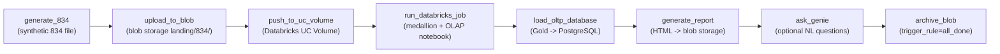

# 21. Airflow DAG Implementation

> Source: [`05_orchestration/airflow/01_dags/med834_e2e_pipeline.py`](https://github.com/yourusername/medenroll834/blob/main/05_orchestration/airflow/01_dags/med834_e2e_pipeline.py)

`med834_e2e_pipeline` is written with Airflow's **TaskFlow API**
(`@dag`/`@task` decorators), which keeps each stage as a typed Python
function with explicit inputs/outputs instead of operator boilerplate.

## DAG declaration

```python
@dag(
    dag_id="med834_e2e_pipeline",
    description="MedEnroll834 e2e: 834 -> blob storage -> UC Volume -> Databricks -> OLTP DB -> Report/Genie",
    default_args={"owner": "med834enrl", "retries": 1, "retry_delay": timedelta(minutes=3)},
    schedule="@daily",
    start_date=pendulum.datetime(2026, 1, 1, tz="UTC"),
    catchup=False,
    tags=["med834enrl", "e2e", "medallion", "blob-storage"],
)
def med834_e2e():
    ...
```

`catchup=False` means no backfill runs are scheduled for the gap between
`start_date` and "now" — only the daily run going forward. Every task
inherits `retries=1` with a 3-minute delay from `default_args`.

## Task graph



```python
local = generate_834()
uploaded = upload_to_blob(local)
pushed = push_to_uc_volume(uploaded)
run_id = run_databricks_job(pushed)
summary = load_oltp_database(run_id)
report = generate_report(summary)
genie = ask_genie(report)
archive_blob(genie)
```

## Why files are staged into a Unity Catalog Volume

```python
UC_VOLUME_PATH = "/Volumes/med834enrl/edi/landing/834"
```

Serverless Databricks Free Edition **cannot read external buckets
directly**, so `push_to_uc_volume` downloads each file from blob storage
and re-uploads it into the UC Volume via `WorkspaceClient().files.upload()`
before the Databricks job runs:

```python
@task
def push_to_uc_volume(_uploaded: list[str]) -> int:
    from databricks.sdk import WorkspaceClient
    from src.medenroll834.storage import blob_storage
    w = WorkspaceClient()
    w.files.create_directory(UC_VOLUME_PATH)
    count = 0
    for key in blob_storage.list_landing_files("landing/834/"):
        name = key.split("/")[-1]
        local = f"/tmp/{name}"
        blob_storage.download_file(key, local)
        with open(local, "rb") as fh:
            w.files.upload(f"{UC_VOLUME_PATH}/{name}", fh, overwrite=True)
        count += 1
    return count
```

This is a POC-specific hop — in the enterprise target architecture where
the landing layer is AWS S3 directly, a Databricks job with an instance
profile can read S3 natively and this staging task would be unnecessary.

## Running and waiting on the Databricks job

```python
@task
def run_databricks_job(_count: int) -> int:
    from databricks.sdk import WorkspaceClient
    job_id = int(_cfg("DATABRICKS_JOB_ID"))
    run = WorkspaceClient().jobs.run_now_and_wait(job_id=job_id)
    state = run.state.result_state.value if run.state and run.state.result_state else "UNKNOWN"
    if state != "SUCCESS":
        raise RuntimeError(f"Databricks job failed: {state}")
    return run.run_id
```

`run_now_and_wait()` blocks the Airflow task until the Databricks job
finishes, so Airflow's own retry mechanism covers both transient Databricks
API failures and job-level failures — a non-`SUCCESS` result state is
raised as a Python exception, which Airflow treats as a task failure
subject to the DAG's `retries=1`.

## Archive runs even if analytics fail

```python
@task(trigger_rule="all_done")
def archive_blob(_genie: dict) -> int:
    from src.medenroll834.storage import blob_storage
    moved = 0
    for key in blob_storage.list_landing_files("landing/834/"):
        blob_storage.archive_834(key)
        moved += 1
    return moved
```

`trigger_rule="all_done"` means `archive_blob` runs regardless of whether
`generate_report` or `ask_genie` succeeded or failed upstream — a
deliberate operational decision: landing files should not be left
"in-flight" forever just because an optional analytical step (Genie) had a
transient issue. See [Chapter 23](23-error-handling-retry.md).

## Genie is skippable

```python
@task
def ask_genie(_report_uri: str) -> dict:
    space_id = _cfg("GENIE_SPACE_ID")
    if not space_id:
        print("GENIE_SPACE_ID not set - skipping Genie step")
        return {"skipped": True}
    ...
```

Genie is strictly optional — the DAG runs end to end with just the HTML
report path if `GENIE_SPACE_ID` is unset. See
[Chapter 28](28-genie-genai.md).

## Validated DAG import

The DAG has been verified to load with **zero import errors** in the live
Airflow scheduler:

```bash
docker exec medenroll834-airflow-scheduler-1 airflow dags list-import-errors
# -> No data found
```

See [Chapter 33](33-end-to-end-execution.md) for the full step-by-step
runbook to deploy and trigger this DAG.
