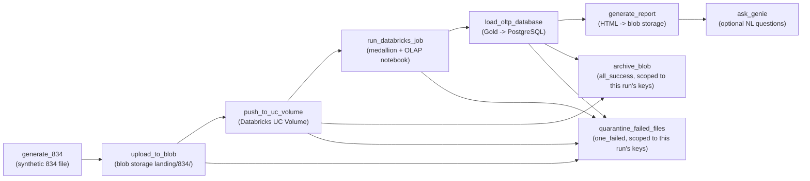
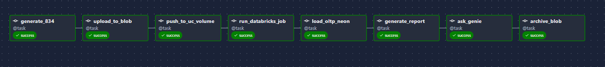
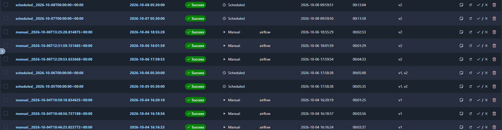

# 21. Airflow DAG Implementation

> Source: [`05_orchestration/airflow/01_dags/med834_e2e_pipeline.py`](https://github.com/yourusername/medenroll834/blob/main/05_orchestration/airflow/01_dags/med834_e2e_pipeline.py)

`med834_e2e_pipeline` is written with Airflow's **TaskFlow API**
(`@dag`/`@task` decorators), which keeps each stage as a typed Python
function with explicit inputs/outputs instead of operator boilerplate.

## DAG declaration

```python
@dag(
    dag_id="med834_e2e_pipeline",
    description="MedEnroll834 e2e: 834 -> blob storage -> UC Volume -> Databricks -> OLTP DB -> Report/Genie",
    default_args={"owner": "med834enrl", "retries": 1, "retry_delay": timedelta(minutes=3)},
    schedule="@daily",
    start_date=pendulum.datetime(2026, 1, 1, tz="UTC"),
    catchup=False,
    tags=["med834enrl", "e2e", "medallion", "blob-storage"],
)
def med834_e2e():
    ...
```

`catchup=False` means no backfill runs are scheduled for the gap between
`start_date` and "now" — only the daily run going forward. Every task
inherits `retries=1` with a 3-minute delay from `default_args`.

## Task graph



```python
local = generate_834()
uploaded = upload_to_blob(local)          # returns exact blob keys, e.g.
                                           # ["landing/834/enrollment_...834"]
pushed = push_to_uc_volume(uploaded)      # pushes + returns the same keys
run_id = run_databricks_job(pushed)
summary = load_oltp_database(run_id)
report = generate_report(summary)
genie = ask_genie(report)

# archive_blob depends on the core chain's own outputs (pushed, summary),
# not on genie -- default all_success trigger rule means Airflow skips it
# automatically if push/Databricks/OLTP failed.
archive_blob(pushed) << summary

# quarantine_failed_files (trigger_rule="one_failed") is wired to the same
# core chain and fires if any of those tasks failed or were UPSTREAM_FAILED,
# moving this run's exact files to failed/834/ instead of landing/834/.
quarantine_failed_files(uploaded) << [pushed, run_id, summary]
```

`uploaded`/`pushed` carry the **exact blob keys this run touched** end to
end via XCom -- `push_to_uc_volume`, `archive_blob`, and
`quarantine_failed_files` all operate on that list directly rather than
re-listing `landing/834/`, so a concurrent or straggling file from another
run can never be mistakenly archived or quarantined alongside this run's
files. See [Chapter 23](23-error-handling-retry.md) for why this replaced
an earlier `trigger_rule="all_done"` + re-list design that could archive a
file Databricks had actually failed to process.

## Why files are staged into a Unity Catalog Volume

```python
UC_VOLUME_PATH = "/Volumes/med834enrl/edi/landing/834"
```

Serverless Databricks Free Edition **cannot read external buckets
directly**, so `push_to_uc_volume` downloads each file from blob storage
and re-uploads it into the UC Volume via `WorkspaceClient().files.upload()`
before the Databricks job runs:

```python
@task
def push_to_uc_volume(keys: list[str]) -> list[str]:
    """Pushes only the exact keys this run uploaded (received as an
    argument, never a fresh blob_storage.list_landing_files() call) and
    passes that same key list through unchanged."""
    from databricks.sdk import WorkspaceClient
    from src.medenroll834.storage import blob_storage
    w = WorkspaceClient()
    w.files.create_directory(UC_VOLUME_PATH)
    for key in keys:
        name = key.split("/")[-1]
        local = f"/tmp/{name}"
        blob_storage.download_file(key, local)
        with open(local, "rb") as fh:
            w.files.upload(f"{UC_VOLUME_PATH}/{name}", fh, overwrite=True)
    return keys
```

This is a POC-specific hop — in the enterprise target architecture where
the landing layer is AWS S3 directly, a Databricks job with an instance
profile can read S3 natively and this staging task would be unnecessary.

## Running and waiting on the Databricks job

```python
@task
def run_databricks_job(_pushed_keys: list[str]) -> int:
    from databricks.sdk import WorkspaceClient
    job_id = int(_cfg("DATABRICKS_JOB_ID"))
    run = WorkspaceClient().jobs.run_now_and_wait(job_id=job_id)
    state = run.state.result_state.value if run.state and run.state.result_state else "UNKNOWN"
    if state != "SUCCESS":
        raise RuntimeError(f"Databricks job failed: {state}")
    return run.run_id
```

`run_now_and_wait()` blocks the Airflow task until the Databricks job
finishes, so Airflow's own retry mechanism covers both transient Databricks
API failures and job-level failures — a non-`SUCCESS` result state is
raised as a Python exception, which Airflow treats as a task failure
subject to the DAG's `retries=1`.

## Archiving is scoped and success-gated; failures are quarantined, not archived

```python
@task
def archive_blob(keys: list[str]) -> int:
    """No trigger_rule override -- default all_success means Airflow skips
    this task automatically if push_to_uc_volume, run_databricks_job, or
    load_oltp_database failed. Wired directly off those tasks' outputs
    (pushed, summary), not off the optional generate_report/ask_genie
    branch."""
    from src.medenroll834.storage import blob_storage
    for key in keys:
        blob_storage.archive_834(key)
    return len(keys)


@task(trigger_rule="one_failed")
def quarantine_failed_files(keys: list[str] | None) -> int:
    """Fires if any task in the core chain (push_to_uc_volume,
    run_databricks_job, load_oltp_database, or upload_to_blob itself)
    failed or was UPSTREAM_FAILED. Moves this run's exact files to
    failed/834/ instead of leaving them ambiguous in landing/834/ or
    archiving them as if they had succeeded."""
    keys = keys or []
    if not keys:
        return 0
    from src.medenroll834.storage import blob_storage
    for key in keys:
        blob_storage.archive_834(key, archive_prefix="failed/834/")
    return len(keys)
```

An earlier version used `trigger_rule="all_done"` on a single `archive_blob`
task that re-listed `landing/834/` from scratch — that let archiving run
(and silently move files) even when `run_databricks_job`/`load_oltp_database`
had failed, and it was not scoped to the files this run actually uploaded.
The current design fixes both problems: `archive_blob` only runs on full
core-chain success and only touches this run's exact keys (passed through
via XCom from `upload_to_blob`), while `quarantine_failed_files` handles the
failure path explicitly by relocating those same keys to `failed/834/`
rather than silently archiving or leaving them in `landing/834/`. See
[Chapter 23](23-error-handling-retry.md) for the full failure-handling
rationale.

## Genie is skippable

```python
@task
def ask_genie(_report_uri: str) -> dict:
    space_id = _cfg("GENIE_SPACE_ID")
    if not space_id:
        print("GENIE_SPACE_ID not set - skipping Genie step")
        return {"skipped": True}
    ...
```

Genie is strictly optional — the DAG runs end to end with just the HTML
report path if `GENIE_SPACE_ID` is unset. See
[Chapter 28](28-genie-genai.md).

## Validated DAG import

The DAG has been verified to load with **zero import errors** in the live
Airflow scheduler:

```bash
docker exec medenroll834-airflow-scheduler-1 airflow dags list-import-errors
# -> No data found
```

See [Chapter 33](33-end-to-end-execution.md) for the full step-by-step
runbook to deploy and trigger this DAG.

## Verified run evidence





