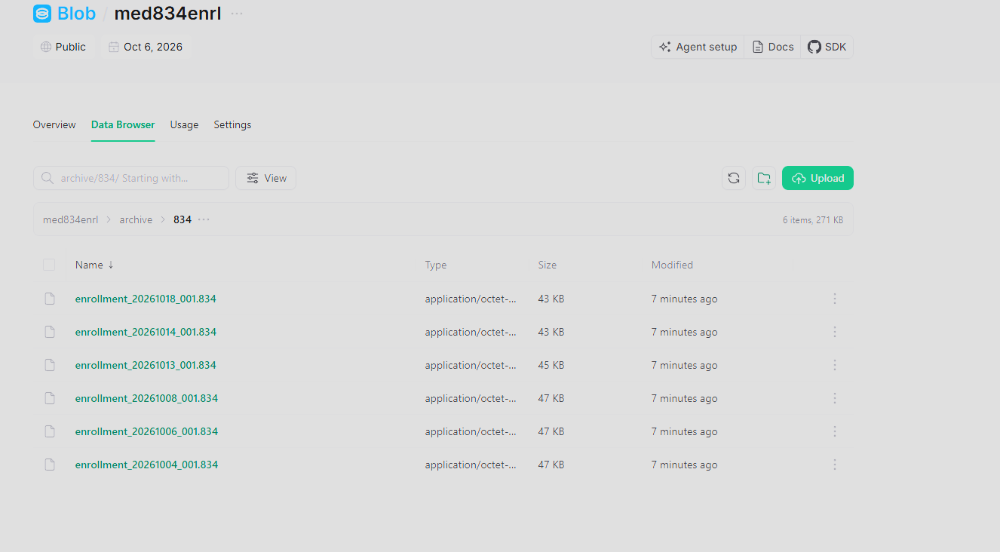

# 23. Error Handling & Retry

## Airflow-level retries

Every task in `med834_e2e_pipeline` inherits a blanket retry policy from
`default_args`:

```python
DEFAULT_ARGS = {"owner": "med834enrl", "retries": 1, "retry_delay": timedelta(minutes=3)}
```

A single transient failure (a Databricks API hiccup, a momentary network
blip to blob storage) is automatically retried once, 3 minutes later,
before the task — and the whole DAG run — is marked failed.

## Explicit failure propagation from Databricks

`run_databricks_job` treats a non-`SUCCESS` Databricks job result as a hard
Python exception, so Airflow's retry/alerting machinery applies uniformly
to both "the API call failed" and "the job ran but produced a bad result":

```python
@task
def run_databricks_job(_count: int) -> int:
    run = WorkspaceClient().jobs.run_now_and_wait(job_id=job_id)
    state = run.state.result_state.value if run.state and run.state.result_state else "UNKNOWN"
    if state != "SUCCESS":
        raise RuntimeError(f"Databricks job failed: {state}")
    return run.run_id
```

## Transactional rollback (OLTP)

The OLTP loader and schema deployment script both catch broadly and roll
back on **any** exception, re-raising afterward so Airflow still sees the
task as failed:

```python
try:
    ...  # all inserts/upserts in one transaction
    conn.commit()
except Exception:
    conn.rollback()
    raise
finally:
    cur.close()
    conn.close()
```

This guarantees the OLTP database never ends up partially loaded — a
retry of `load_oltp_database` after a rollback starts from the same
pre-load state, re-running the (idempotent, see
[Chapter 22](22-idempotency-incremental-processing.md)) upsert logic
cleanly.

## Per-query error isolation in reporting

The HTML report generator does **not** let one failing analytics query take
down the whole report — each `REPORT_QUERIES` entry is wrapped
individually:

```python
for title, sql in REPORT_QUERIES:
    try:
        cols, rows = _run_query(w, wid, sql)
        sections.append(_table_html(title, cols, rows))
    except Exception as exc:
        sections.append(f"<h2>{title}</h2><p style='color:red'>Error: {exc}</p>")
```

A broken query renders as a visible red error message inline in the
generated HTML report instead of crashing the `generate_report` task and
blocking the rest of the report's sections — a deliberate degrade-gracefully
choice for an analytics/reporting path (as opposed to the OLTP load, which
intentionally fails hard and rolls back, because operational data integrity
matters more than reporting completeness).

## Operational failure handling: archive vs. quarantine

```python
@task
def archive_blob(keys: list[str]) -> int:
    ...  # default all_success trigger rule

@task(trigger_rule="one_failed")
def quarantine_failed_files(keys: list[str] | None) -> int:
    ...
```

Unlike an earlier `trigger_rule="all_done"` design (which re-listed
`landing/834/` from scratch and could archive a file Databricks had
actually failed to process), the archive/quarantine split is now both
**run-scoped** and **failure-aware**:

- `archive_blob` has the **default `all_success`** trigger rule and is
  wired directly to `push_to_uc_volume`/`load_oltp_database`'s own XCom
  outputs (not to the optional `generate_report`/`ask_genie` branch), so
  Airflow automatically skips it if any task in the core processing chain
  failed — it is structurally impossible for it to archive a file that
  Databricks or the OLTP load never actually succeeded on.
- `quarantine_failed_files` uses `trigger_rule="one_failed"` and is wired
  to every task in that same core chain (`upload_to_blob`,
  `push_to_uc_volume`, `run_databricks_job`, `load_oltp_database`).
  Airflow's `ONE_FAILED` rule fires whenever a direct upstream is `FAILED`
  **or** `UPSTREAM_FAILED` — confirmed against the Airflow 3.3.0
  `TriggerRuleDep` source — so a failure anywhere in the chain reaches this
  task even if it only manifests several hops downstream as
  `UPSTREAM_FAILED`. It moves this run's exact files to `failed/834/`
  instead of leaving them ambiguous in `landing/834/`.
- Both tasks operate on the **exact blob keys this run uploaded**
  (`upload_to_blob` returns them, threaded unchanged through
  `push_to_uc_volume` via XCom) rather than re-listing the bucket, so a
  concurrent run's files are never touched by either path.
- A missing/`None` `keys` XCom (e.g. `upload_to_blob` itself is what
  failed, so it never returned anything) is handled as a no-op in
  `quarantine_failed_files`, not an error — there is nothing to move.

The DAG run as a whole is still reported as failed if any upstream task
failed; archive/quarantine only decide what happens to the landing files,
not the DAG run's final state.

## Validation errors are not failures

A critical distinction in this pipeline: a member record failing
**data-quality validation** is not a pipeline failure — it is expected,
handled output. `is_valid=False` rows are quarantined (see
[Chapter 16](16-data-quality-reject-handling.md)), not raised as
exceptions; only infrastructure/connectivity/job-level problems trigger
Airflow's retry and failure-reporting path.

## Known error classes and their handling

| Failure | Where caught | Behavior |
|---|---|---|
| Databricks job non-`SUCCESS` | `run_databricks_job` task | `RuntimeError` → Airflow retry (1x) → DAG failure |
| OLTP connection/constraint error | `load_gold_to_oltp()` | Transaction rollback → re-raise → Airflow retry |
| Blob storage token expired/invalid | any `blob_storage.*` call | `requests`/`boto3` exception → Airflow retry |
| Single bad analytics SQL query | `generate_report()` | Caught per-query, rendered as an error row, report still completes |
| Member record fails validation | `SilverLayer._apply_validation()` | Not an exception — routed to quarantine (see Ch. 16) |
| Databricks SQL warehouse read failure | `_run_query()` / `_read_gold_from_databricks()` | `RuntimeError` with the Databricks error message, propagated up |
| Core chain (push/Databricks/OLTP) failure | `quarantine_failed_files` (`trigger_rule="one_failed"`) | This run's exact files moved to `failed/834/`; never archived |

## Verified archive evidence



