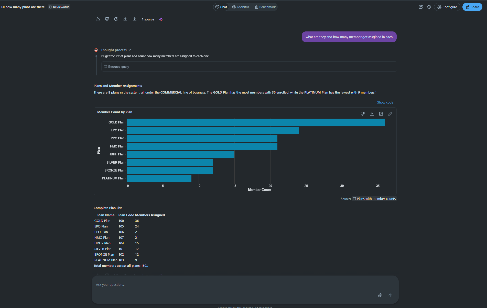

# 28. Genie / GenAI

> Source: [`src/medenroll834/reporting/report_generator.py`](https://github.com/yourusername/medenroll834/blob/main/src/medenroll834/reporting/report_generator.py)
> (`ask_genie()`)

Databricks Genie is the pipeline's **natural-language analytics**
consumer — the second of the two analytical consumption modes described in
[Chapter 4](04-modern-architecture.md#4-analytical-consumption-two-modes).
It queries the exact same governed Gold/OLAP tables as the HTML report; it
is not a different data source and not a pipeline transformation step.

## Implementation

```python
def ask_genie(space_id: str, question: str, profile=None) -> Dict:
    """Ask a Databricks Genie space a natural-language question.

    Requires a Genie space (space_id) in a workspace with Genie enabled.
    Returns the final message payload. Best-effort: raises if Genie API or
    space is unavailable.
    """
    w = _client(profile)
    conv = w.genie.start_conversation_and_wait(space_id=space_id, content=question)
    out = {"question": question, "attachments": []}
    for att in (conv.attachments or []):
        if att.text:
            out["attachments"].append({"type": "text", "content": att.text.content})
        if att.query:
            out["attachments"].append({"type": "query", "query": att.query.query,
                                        "description": att.query.description})
    return out
```

`start_conversation_and_wait()` blocks until Genie has processed the
question and returns, synchronously, a list of **attachments** — each
either a natural-language text answer or a generated SQL query (with
description) that Genie ran to produce that answer. Surfacing the
generated SQL alongside the text answer is valuable for auditability: a
reviewer can see exactly what query Genie executed against the governed
Gold/OLAP data, not just trust an opaque answer.

## Invoked from the Airflow DAG (optional)

```python
@task
def ask_genie(_report_uri: str) -> dict:
    space_id = _cfg("GENIE_SPACE_ID")
    if not space_id:
        print("GENIE_SPACE_ID not set - skipping Genie step")
        return {"skipped": True}
    from src.medenroll834.reporting.report_generator import ask_genie as genie
    qs = ["How many members are enrolled on each plan?",
          "What is the subscriber to dependent ratio?"]
    answers = [genie(space_id, q) for q in qs]
    return {"answers": answers}
```

Two representative questions are asked on every DAG run when
`GENIE_SPACE_ID` is configured — chosen because they mirror two of the
HTML report's own queries ("Members by plan", "Subscriber vs dependent"),
demonstrating that the NL path and the fixed-SQL path answer the same
underlying business questions through different interfaces.

## Enabling Genie

From the [E2E Pipeline Runbook](https://github.com/yourusername/medenroll834/blob/main/08_docs/04_operations_deployment/E2E_PIPELINE_RUNBOOK.md):

1. In Databricks: **Genie → New space**, add `med834enrl.edi.gold_enrollments`
   and `med834enrl.gold.*` tables as the space's data.
2. Copy the space id from the URL and set `GENIE_SPACE_ID` in `.env`.
3. Re-run the DAG; `ask_genie` now queries the same governed Gold/OLAP data
   as the HTML report.

## Why Genie is optional, not required

`GENIE_SPACE_ID` is intentionally unset by default — the pipeline runs
fully end-to-end (generation → ingestion → medallion → OLTP → HTML report
→ archive) with Genie entirely skipped. This reflects its position as an
**additional** analytical consumption mode layered on top of a complete,
independently-functioning pipeline, not a required dependency of it.

## Positioning note (why this matters architecturally)

A common modernization-story mistake is to treat an AI/NL feature as part
of the data pipeline's transformation logic. This repo deliberately keeps
Genie downstream of Gold/OLAP, alongside — not inside — the HTML reporting
path, so:

- Pipeline reliability (Bronze/Silver/Gold/OLTP) never depends on Genie's
  availability.
- Both consumption modes are governed by the same data quality rules
  applied upstream (see [Chapter 16](16-data-quality-reject-handling.md)) —
  Genie cannot "see" data that never passed validation.
- Swapping or removing Genie has zero blast radius on the rest of the
  system — see [Chapter 4](04-modern-architecture.md) for the architectural
  framing this reflects.

## Verified Genie evidence



