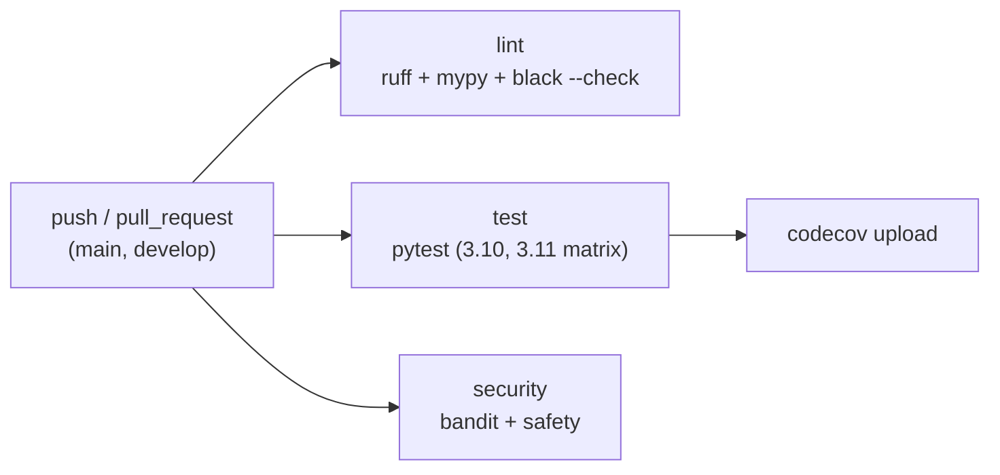
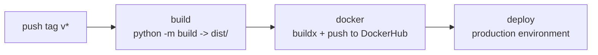

# 31. CI/CD

> Source: [`.github/workflows/ci.yml`](https://github.com/yourusername/medenroll834/blob/main/.github/workflows/ci.yml),
> [`.github/workflows/cd.yml`](https://github.com/yourusername/medenroll834/blob/main/.github/workflows/cd.yml)

## CI pipeline (`ci.yml`)

Triggered on every push/PR to `main` or `develop`, with three parallel jobs:



```yaml
jobs:
  lint:
    steps:
      - run: pip install -r requirements.txt
      - run: ruff check src/ tests/
      - run: mypy src/
      - run: black --check src/ tests/

  test:
    strategy:
      matrix:
        python-version: ['3.10', '3.11']
    steps:
      - run: pytest tests/ -v --cov=src --cov-report=xml --cov-report=term-missing
      - uses: codecov/codecov-action@v3

  security:
    steps:
      - run: pip install bandit safety
      - run: bandit -r src/ -f json -o bandit-report.json
      - run: safety check --json > safety-report.json
```

- **`lint`** — `ruff` (fast linter), `mypy` (static typing), `black
  --check` (formatting, no auto-fix in CI).
- **`test`** — runs across a **Python 3.10 / 3.11 matrix**, uploads
  coverage to Codecov.
- **`security`** — `bandit` (static security scan of `src/`) and `safety`
  (dependency vulnerability check) — see [Chapter 29](29-security.md).

!!! warning "Known path discrepancy"
    `ci.yml` references `tests/`, but the test suite actually lives at
    `02_tests/` per the repository's numbered-directory convention (see
    [Chapter 6](06-repository-structure.md)) and `pyproject.toml`'s
    `testpaths = ["02_tests"]`. This is a real, currently-unresolved
    mismatch left over from before the repo's enterprise-standard
    reorganization — running `pytest tests/` in CI as written would not
    find the test suite at `02_tests/`. Fixing `ci.yml` to reference
    `02_tests/` (matching the `Makefile`'s `pytest 02_tests/ -v` target) is
    tracked as a concrete item in
    [Chapter 38](38-future-improvements.md).

## CD pipeline (`cd.yml`)

Triggered only on version tags (`v*`):



```yaml
jobs:
  build:
    steps:
      - run: pip install build twine
      - run: python -m build
      - uses: actions/upload-artifact@v3
        with: { name: dist, path: dist/ }

  docker:
    needs: build
    steps:
      - uses: docker/login-action@v3
        with:
          username: ${{ secrets.DOCKERHUB_USERNAME }}
          password: ${{ secrets.DOCKERHUB_TOKEN }}
      - uses: docker/build-push-action@v5
        with: { context: ., push: true, tags: ..., labels: ... }

  deploy:
    needs: [build, docker]
    environment: production
    steps:
      - run: echo "Deployment steps would go here"
```

The `deploy` job is a **documented placeholder** — it runs in a GitHub
Environment named `production` (so it can be gated with required
reviewers/approval rules in repo settings) but the actual deployment
command (`kubectl apply` / `helm upgrade`) is intentionally commented out,
since this POC has no Kubernetes/Helm target yet.

## Documentation site deployment (this handbook)

This GitBook-style handbook (`docs-site/`) is built and deployed by its own
dedicated workflow — see
[`.github/workflows/docs.yml`](https://github.com/yourusername/medenroll834/blob/main/.github/workflows/docs.yml) — on every
push to `main` that touches `docs-site/**`, publishing to GitHub Pages via
`mkdocs gh-deploy`. This is the practical "docs-as-code" delivery mechanism
requested for this project: documentation changes ship through the exact
same pull-request review process as code changes.

## Local equivalents (Makefile)

```makefile
install: pip install -r requirements.txt && pip install -e .
test:    pytest 02_tests/ -v --cov=src --cov-report=term-missing
lint:    ruff check src/ 02_tests/ && mypy src/
format:  black src/ 02_tests/ && ruff check --fix src/ 02_tests/
```

Running `make lint test` locally before pushing exercises the same
ruff/mypy/pytest checks CI will run (modulo the `tests/` vs. `02_tests/`
discrepancy noted above), catching most CI failures before they happen.
